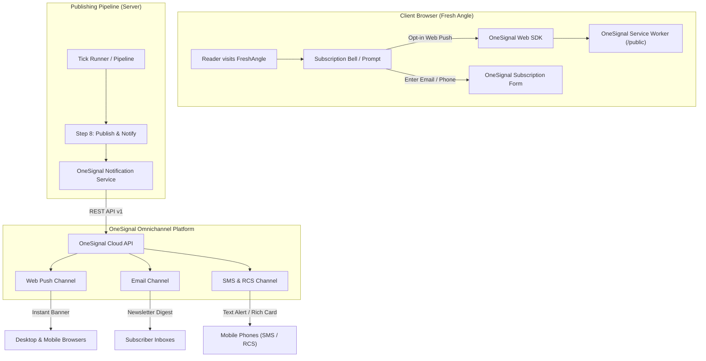

# OneSignal Omnichannel Notification Architecture & Implementation Plan

This document outlines the end-to-end strategy to integrate **OneSignal** into **Fresh Angle** across all major subscriber channels: **Web Push (Browser)**, **Email**, **SMS**, and **RCS**.

Branch: `feature/onesignal-notifications`

---

## 1. Goal Description

Fresh Angle currently notifies the site owner via Telegram when an article is published. To turn readers into recurring audience members, we will introduce an **Omnichannel Notification Engine** powered by OneSignal.

Whenever an article is drafted, reviewed, and published by the autonomous pipeline (or manual admin trigger), Fresh Angle will broadcast updates across subscribed channels:
1. **Browser Web Push**: Native desktop and mobile browser notifications (Chrome, Safari, Firefox, Edge, Android, iOS PWA) with post title, excerpt, and cover image.
2. **Email Delivery**: Automated email newsletter broadcasts to subscribers with rich HTML previews.
3. **SMS / RCS Messaging**: Short breaking-news alerts sent via carrier SMS and modern RCS rich cards.



---

## 2. User Review Required

> [!IMPORTANT]
> **OneSignal Account & Credentials Setup**:
> To enable live delivery, you will need to create a free app on [OneSignal.com](https://onesignal.com) and obtain:
> 1. `NEXT_PUBLIC_ONESIGNAL_APP_ID`: Public Application ID for browser SDK initialization.
> 2. `ONESIGNAL_REST_API_KEY`: Secret Server REST API Key for dispatching notifications from Next.js server actions and GitHub Actions.
> 3. For **SMS / RCS**: Connecting a Twilio or Telnyx sender in the OneSignal dashboard.
> 4. For **Email**: Connecting your custom domain email provider (Mailgun, SendGrid, or OneSignal default) in the OneSignal dashboard.

> [!NOTE]
> The integration will be designed with **graceful feature flags**: if `ONESIGNAL_REST_API_KEY` is not present, notification dispatch will safely log a warning and continue without breaking post generation or existing Telegram alerts.

---

## 3. Open Questions & Design Decisions

1. **Opt-in Prompt Trigger**:
   - *Option A (Recommended)*: Slidedown prompt / Floating Bell icon on the bottom-right corner after 10 seconds or after reading 50% of an article.
   - *Option B*: Standard native browser prompt immediately on first page load (can feel intrusive to new visitors).
2. **Channel Cadence**:
   - *Web Push*: Broadcast every published post (up to 9 posts/day), or only high-importance / breaking posts?
   - *Email / SMS*: Broadcast every post, or batch into a single daily/weekly summary to prevent inbox fatigue and SMS carrier costs?
3. **Category-Based Filtering**:
   - Should readers be able to select specific categories (e.g., only "AI Hardware" or "Agentic Models") in their notification preferences?

---

## 4. Proposed Architecture & Changes

### Component 1: Environment & Config
#### [MODIFY] `src/lib/env.ts`
Add validation for OneSignal secrets:
```typescript
NEXT_PUBLIC_ONESIGNAL_APP_ID: z.string().optional(),
ONESIGNAL_REST_API_KEY: z.string().optional(),
ONESIGNAL_SMS_SENDER: z.string().optional(),
```

#### [MODIFY] `.env.example`
Add documentation entries for OneSignal configuration.

---

### Component 2: Client-Side Web Push & Prompt SDK
#### [NEW] `public/OneSignalSDKWorker.js`
Standard service worker entry point required by browser Push API:
```javascript
importScripts("https://cdn.onesignal.com/sdks/web/v16/OneSignalSDK.sw.js");
```

#### [NEW] `src/components/notifications/OneSignalInit.tsx`
Client component initialized in `src/app/layout.tsx`:
- Dynamically loads `https://cdn.onesignal.com/sdks/web/v16/OneSignalSDK.page.js` without blocking First Contentful Paint.
- Initializes with `NEXT_PUBLIC_ONESIGNAL_APP_ID`.
- Configures soft-prompt / slide-down permissions dialog and subscription state listeners.

#### [NEW] `src/components/notifications/SubscribeModal.tsx`
A dedicated subscription modal and floating bell widget allowing users to:
- Enable/disable Web Push.
- Input Email for article alerts.
- Input Phone number for SMS/RCS notifications.
- Tag user interests (categories).

---

### Component 3: Server-Side Broadcast Service
#### [NEW] `src/services/notify/onesignal.ts`
Server-side module invoking OneSignal REST API v1 (`https://onesignal.com/api/v1/notifications`):
```typescript
export interface BroadcastNotificationParams {
  title: string;
  excerpt: string;
  url: string;
  imageUrl?: string;
  category?: string;
  channels?: Array<"push" | "email" | "sms" | "rcs">;
}

export async function broadcastPostNotification(
  params: BroadcastNotificationParams,
): Promise<{ success: boolean; id?: string; error?: string }>
```
- **Web Push payload**: Headings, body excerpt, icon, `big_picture` (Cloudflare Flux-1 cover image), destination URL.
- **Email payload**: Subject line, HTML email template with post preview and "Read More" button.
- **SMS / RCS payload**: Compact message with short link.

#### [MODIFY] `src/services/pipeline/steps/publish.ts`
Connect `broadcastPostNotification` into Step 8 (`stepPublishAndNotify`), dispatching to OneSignal alongside Telegram and IndexNow.

---

### Component 4: Admin Notification Console
#### [NEW] `src/app/admin/notifications/page.tsx`
A dedicated admin view to:
- Test send push notifications, emails, and SMS to test devices.
- Toggle per-channel automation on/off.
- View recent broadcast delivery history and recipient counts.

---

## 5. Verification Plan

### Automated Tests
- `npm run typecheck`: Ensure TypeScript safety across new client/server boundaries.
- `npm run lint`: Verify ESLint and styling compliance.
- `tests/onesignal.test.ts`: Unit tests verifying payload construction for push, email, SMS, and RCS, plus graceful fallback when API keys are absent.

### Manual Verification
1. Run local dev server (`npm run dev`).
2. Visit homepage and verify the OneSignal floating bell / prompt renders smoothly without layout shifts.
3. Test subscription opt-in using a mock or live `APP_ID`.
4. Trigger a test notification from the Admin panel and verify delivery payload structure.
